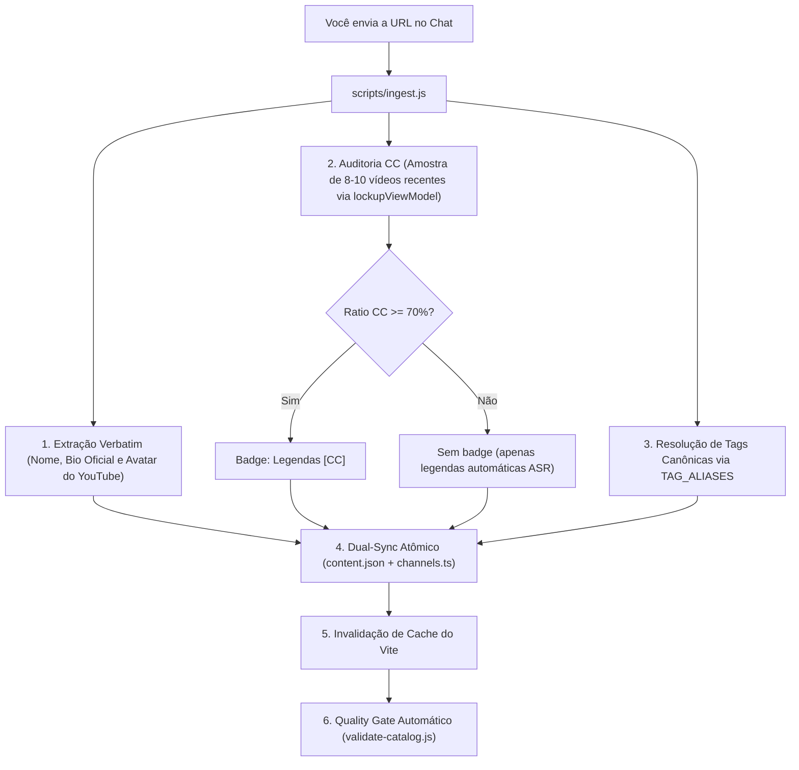

# 📺 Guia: Como Adicionar Canais do YouTube pelo Chat

Este guia ensina como adicionar novos canais do YouTube à biblioteca diretamente aqui no chat com o assistente, aproveitando a extração automática de metadados e a auditoria de legendas em 10 vídeos.

---

## 1. O Jeito Mais Rápido: Basta Colar o Link

Você não precisa preencher formulários nem digitar JSON. Basta enviar a URL do canal (ou uma lista de URLs) aqui no chat:

### Exemplo 1: Canal Individual (Zero Configuração)
```text
Adicione este canal: https://www.youtube.com/@deutschmitlara
```

### Exemplo 2: Adição em Lote (Batch)
```text
Adicione esses canais à biblioteca:
- https://www.youtube.com/@Dave2D
- https://www.youtube.com/@Mrwhosetheboss
- https://www.youtube.com/@TheVerge
```

### Exemplo 3: Link com Ajustes Específicos (Opcional)
```text
Adicione https://www.youtube.com/@snazzylabs em Inglês, categoria Imersão, tags: Tecnologia, Engenharia
```

---

## 2. Ingestion Engine Unificado (`scripts/ingest.js`)

Nos bastidores, o assistente agora utiliza um **motor de ingestão único, atômico e determinístico**, sem scripts descartáveis improvisados:

```bash
# Executado diretamente pelo assistente via terminal:
node scripts/ingest.js <url1> [url2...] --lang <idioma> [--tags "Tag1,Tag2"] [--beginner]
```



1. **Metadados Oficiais (Anti-Slop):** Puxa o título oficial, avatar real e descrição oficial do canal diretamente do YouTube. Jamais inventa bios sintéticas por IA.
2. **Auditoria de Legendas (10 Vídeos):** Executa o `detectYouTubeCC`, verificando se os últimos 10 vídeos possuem legendas humanas manuais (`kind !== 'asr'`). Se $\ge 70\%$, marca `Legendas [CC]`.
3. **Separação Rigorosa:** Classifica automaticamente entre **Imersão Nativa** (nativos falando para nativos) e **Professores** (ensino do idioma/gramática).
4. **Tags Neutras:** Aplica de 1 a 3 tags do vocabulário padronizado da biblioteca (sem emojis infantis, sem arco-íris de badges).
5. **Persistência & Build:** Atualiza [`app/src/data/content.json`](file:///c:/Users/vitor/Desktop/AI/immersion-library/app/src/data/content.json), sincroniza [`app/src/data/channels.ts`](file:///c:/Users/vitor/Desktop/AI/immersion-library/app/src/data/channels.ts) e compila para garantir integridade.

---

## 3. Comandos Úteis para o Chat

Você pode dar instruções diretas para refinar ou auditar itens:

| Comando | O que faz |
| :--- | :--- |
| `Audite as legendas de https://youtube.com/@canal` | Roda o scanner de 10 vídeos e exibe o relatório detalhado de CC sem salvar. |
| `Mude o canal X para a aba de Professores` | Move de Imersão (`YouTube`) para Professores (`Educacional`). |
| `Atualize as tags do canal X para Tech, Design` | Altera os tópicos do card. |
| `Recarregue os metadados e avatar do canal X` | Re-extrai bio e foto oficial do YouTube caso o canal tenha mudado. |

---

## 4. Regras Pétreas de Qualidade (Lembrete)

* **Imersão vs. Professores:** NUNCA misturar canais didáticos de aula na aba de Imersão Nativa.
* **Legendas:** Apenas legendas humanas contam para o selo `Legendas [CC]`. Legendas puramente automáticas (ASR) ficam sem selo.
* **Descrições:** Sempre fiéis à voz original do criador, sem frases de autoelogio ("canal incrível para aprender", "o melhor do YouTube").

---

## 5. Protocolo de Sincronização & Prevenção de Cache

Para garantir que o que foi adicionado ou deletado apareça imediatamente na interface sem descompasso:
1. **Sincronia Dupla Obrigatória:** O item deve ser escrito em `content.json` E compilado em `channels.ts` via `syncChannelsTsFromData`.
2. **Anti-Zumbi:** Se um item foi deletado, ele é removido de `content.json` para nunca ressuscitar em syncs posteriores.
3. **Invalidação de Cache:** O Vite dev server deve ter seu cache invalidado para forçar a entrega da nova versão do bundle.
4. **Verificação HTTP:** O assistente deve testar `fetch('http://localhost:5173/api/get-channels')` antes de avisar o usuário.
